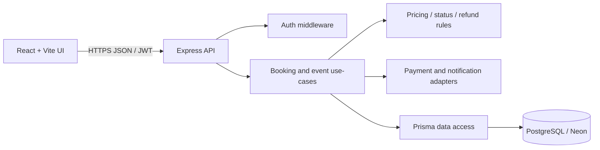
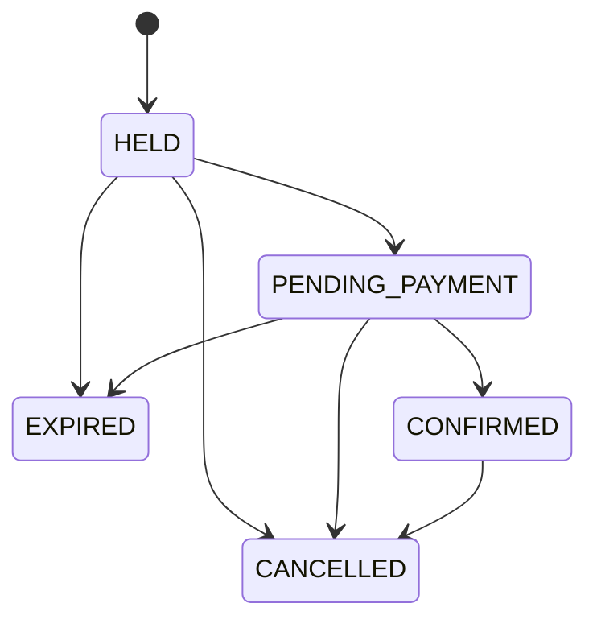

# TicketFlow Architecture

## High-level architecture

## Layers
- **Presentation:** React components and browser fetch calls.
- **HTTP/API:** Express routes, request validation (Zod), authentication/authorization middleware and centralized errors.
- **Application/use-case logic:** event creation, seat holds, payment, cancellation and expiry workflows in API handlers/worker.
- **Domain:** pure booking transition, pricing, refund and hold-expiry functions.
- **Infrastructure:** Prisma repository client, PostgreSQL, mock payment adapters and notification adapters.

## Design patterns used
- **Strategy:** `MockCardProvider` and `MockWalletProvider` implement the same `charge` contract; booking flow selects an adapter by key. Pricing strategy is selected per event and resolved by the pricing domain function.
- **Adapter:** mock payment and notification channels isolate external integration details from booking behavior.
- **Middleware / Chain of Responsibility:** authentication, role authorization, request parsing and centralized error handling run as Express middleware.
- **Repository / Data Mapper:** Prisma provides the persistence abstraction and maps models to PostgreSQL. No extra repository wrapper is added where it would only duplicate Prisma calls.

## SOLID examples
- **S:** pricing, refund and booking transition rules are separate pure modules; payment providers each handle one provider.
- **O:** new payment adapters can be added behind the same `charge` contract without changing the provider implementations.
- **L:** each mock provider can be substituted where the common payment contract is expected.
- **I:** payment adapter exposes only `charge`; notification channel exposes only `send`.
- **D:** payment selection depends on the adapter contract rather than provider-specific request code.

## Concurrency and lifecycle
Seat acquisition uses conditional updates (`status = AVAILABLE`) inside a serializable database transaction. A request succeeds only if the number of updated rows equals the number of requested seats; otherwise the transaction fails. A unique `BookingSeat.seatId` constraint prevents a seat from being attached to multiple bookings. Hold expiry updates the booking status/history and releases expired seat holds. Payment checks the hold deadline before confirming.

## State transitions

## Important limitations
This is an educational MVP. Mock payments do not move money. A production payment integration needs provider-side idempotency and webhook signature verification. Registration role selection is for demonstration and must be restricted in a public production product. Run concurrent integration/load tests against the target database before asserting production-level concurrency guarantees.
